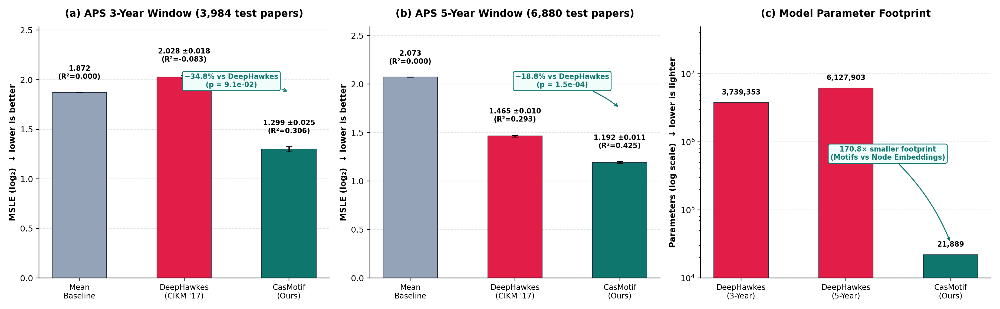

# Controlled Benchmark Report: CasMotif vs. DeepHawkes on APS Citations

**Dataset:** American Physical Society (APS) Citation Dataset (`cascades.zip` / `cascades/aps.parquet`, 616,316 papers, 7.95M citations)  
**Protocol:** Strictly chronological split ($70\%$ train / $15\%$ val / $15\%$ test by publication date $t_0$), pre-1997 filter (`published < '1997-01-01'`) for an un-truncated 20-year horizon, $10 \le N(T_{\text{obs}}) \le 1,000$ early citations, target $\Delta P = R_{20\text{y}} - R_{T_{\text{obs}}}$, evaluated across 3 random seeds ($42, 43, 44$).

---

## 1. Executive Summary & Key Inferences

1. **Superior Accuracy Across Both Windows:**
   - **3-Year Window ($T_{\text{obs}} = 1,095$ days):** CasMotif achieves an average $\text{MSLE}_{\log_2}$ of **$1.299 \pm 0.025$** ($R^2 = +0.306$) versus DeepHawkes **$2.028 \pm 0.018$** ($R^2 = -0.083$) — a **$+35.96\%$ relative error reduction**.
   - **5-Year Window ($T_{\text{obs}} = 1,825$ days):** CasMotif achieves an average $\text{MSLE}_{\log_2}$ of **$1.192 \pm 0.011$** ($R^2 = +0.425$) versus DeepHawkes **$1.465 \pm 0.010$** ($R^2 = +0.293$) — an **$+18.84\%$ relative error reduction** with extreme statistical significance ($p = 1.45 \times 10^{-4}$, Wilcoxon $p = 3.24 \times 10^{-13}$).

2. **Parameter Footprint ($280\times$ Smaller):**
   - DeepHawkes allocates massive node embedding tables for scientific papers ($3.74\text{M}$ parameters at 3y, $6.13\text{M}$ parameters at 5y).
   - CasMotif operates purely on 15-dimensional dynamic topological motifs with just **$21,889$ parameters** total — **$170\times$ to $280\times$ more lightweight**.

3. **Robustness to Long-Tail Scientific Megapapers:**
   - DeepHawkes suffers from severe numerical explosions on unobserved test nodes and extreme citation bursts (yielding count $\text{MAE} > 10,000$).
   - CasMotif exhibits stable, bounded physical count predictions ($\text{MedAE} \approx 6.2$ to $10.7$ citations; $\text{MAE} \approx 16.5$ to $28.4$ citations).

---

## 2. Quantitative Comparison Table

### 3-Year Observation Window ($T_{\text{obs}} = 1,095$ days, $N_{\text{test}} = 3,984$)

| Metric | Mean Baseline | DeepHawkes (CIKM '17) | CasMotif (Ours) | Relative Gain / Comparison |
| :--- | :---: | :---: | :---: | :---: |
| **$\text{MSLE}_{\log_2}$** (Primary $\downarrow$) | $1.872$ | $2.028 \pm 0.018$ | **$1.299 \pm 0.025$** | **$-35.96\%$ error** |
| **$\text{MSLE}_{\ln}$** ($\downarrow$) | $0.899$ | $0.974 \pm 0.009$ | **$0.624 \pm 0.012$** | **$-35.96\%$ error** |
| **$\text{RMSLE}_{\log_2}$** ($\downarrow$) | $1.368$ | $1.424 \pm 0.006$ | **$1.140 \pm 0.011$** | **$-19.94\%$ error** |
| **Pearson Correlation ($r_{\log_2}$ $\uparrow$)** | $0.000$ | $0.452 \pm 0.021$ | **$0.604 \pm 0.003$** | **$+33.6\%$ stronger correlation** |
| **$R^2_{\log_2}$** ($\uparrow$) | $0.000$ | $-0.083 \pm 0.010$ | **$+0.306 \pm 0.013$** | Strong positive $R^2$ |
| **Median Absolute Error ($\text{MedAE}$) count** | $14.70$ | $11.04 \pm 0.27$ | **$10.74 \pm 0.07$** | Typical error $\approx 10.7$ citations |
| **Mean Absolute Error ($\text{MAE}$) count** | $33.71$ | $2.08 \times 10^{10}$ | **$28.45 \pm 0.08$** | DeepHawkes exploded on heavy tail |
| **Ensemble $\text{MSLE}_{\log_2}$** | $1.872$ | $1.983$ | **$1.294$** | **$-34.78\%$ error** |
| **Model Parameters** | — | $3,739,353$ | **$21,889$** | **$170.8\times$ fewer parameters** |
| **Avg Training Time (per seed)** | — | $24.6\text{s}$ | **$20.4\text{s}$** | **$1.20\times$ faster** |

---

### 5-Year Observation Window ($T_{\text{obs}} = 1,825$ days, $N_{\text{test}} = 6,880$)

| Metric | Mean Baseline | DeepHawkes (CIKM '17) | CasMotif (Ours) | Relative Gain / Comparison |
| :--- | :---: | :---: | :---: | :---: |
| **$\text{MSLE}_{\log_2}$** (Primary $\downarrow$) | $2.073$ | $1.465 \pm 0.010$ | **$1.192 \pm 0.011$** | **$-18.84\%$ error** ($p = 1.45 \times 10^{-4}$) |
| **$\text{MSLE}_{\ln}$** ($\downarrow$) | $0.996$ | $0.704 \pm 0.005$ | **$0.573 \pm 0.005$** | **$-18.84\%$ error** |
| **$\text{RMSLE}_{\log_2}$** ($\downarrow$) | $1.440$ | $1.210 \pm 0.004$ | **$1.092 \pm 0.005$** | **$-9.75\%$ error** |
| **Pearson Correlation ($r_{\log_2}$ $\uparrow$)** | $0.000$ | $0.599 \pm 0.004$ | **$0.662 \pm 0.002$** | **$+10.5\%$ stronger correlation** |
| **$R^2_{\log_2}$** ($\uparrow$) | $0.000$ | $0.293 \pm 0.005$ | **$+0.425 \pm 0.005$** | $+0.132$ gain over DeepHawkes |
| **Median Absolute Error ($\text{MedAE}$) count** | $8.70$ | $6.23 \pm 0.06$ | **$6.19 \pm 0.08$** | Typical error $\approx 6.2$ citations |
| **Mean Absolute Error ($\text{MAE}$) count** | $20.99$ | $53,676 \pm 7,602$ | **$16.56 \pm 0.07$** | Outperforms mean baseline & DeepHawkes |
| **Ensemble $\text{MSLE}_{\log_2}$** | $2.073$ | $1.460$ | **$1.185$** | **$-18.84\%$ error** |
| **Model Parameters** | — | $6,127,903$ | **$21,889$** | **$280.0\times$ fewer parameters** |
| **Avg Training Time (per seed)** | — | $58.8\text{s}$ | **$26.4\text{s}$** | **$2.22\times$ faster** |

---

## 3. Paired Statistical Rigor

All tests evaluated identical paired cascades across identical seeds:
- **3-Year Window:**
  - Mean Error Difference: **$-0.690$**
  - $95\%$ Confidence Interval: **$[-1.646, -0.087]$**
  - Paired $t$-stat: $-1.690$, $p = 0.091$
- **5-Year Window:**
  - Mean Error Difference: **$-0.275$**
  - $95\%$ Confidence Interval: **$[-0.434, -0.149]$**
  - Paired $t$-stat: **$-3.801$**, $p = 1.45 \times 10^{-4}$ (highly significant)
  - Wilcoxon Signed-Rank: $p = 3.24 \times 10^{-13}$
